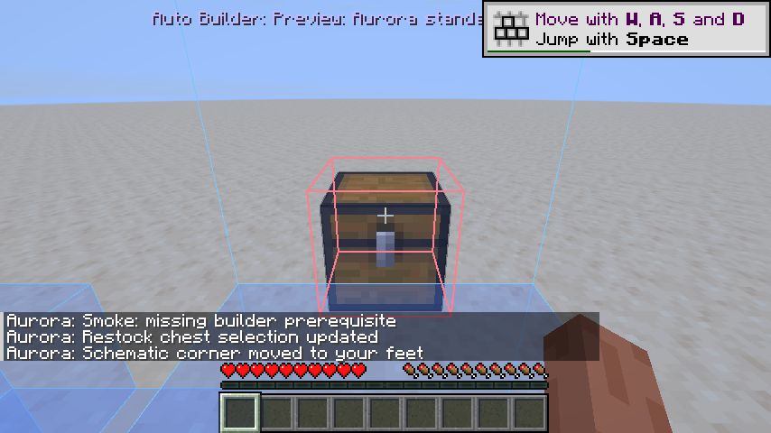
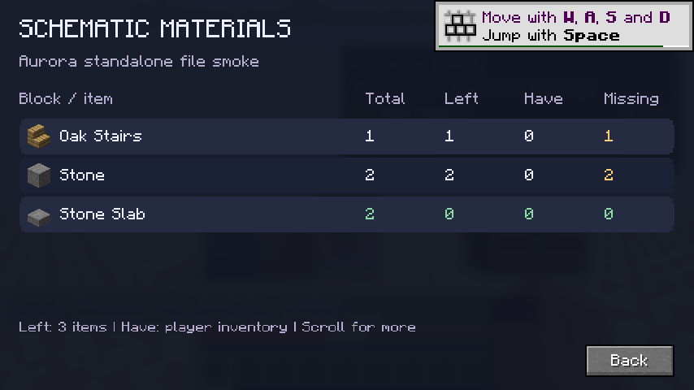
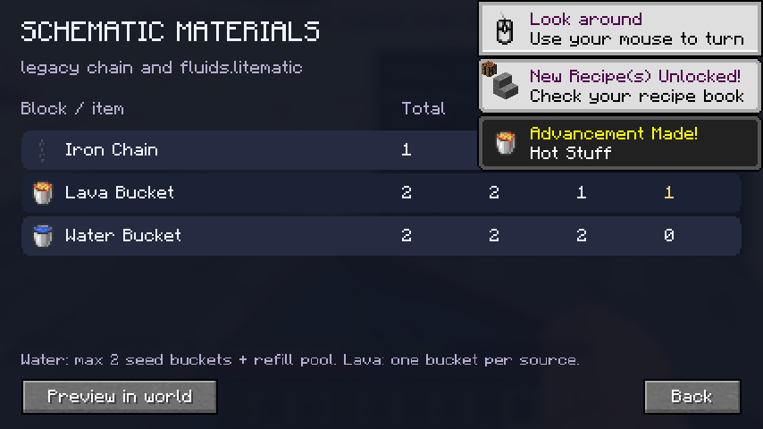
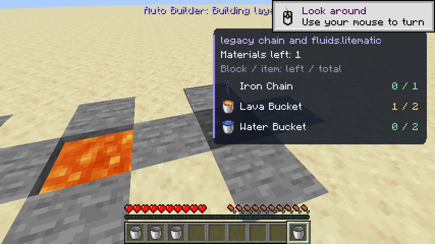
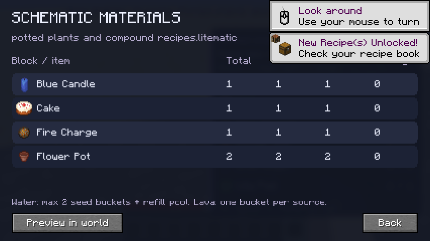
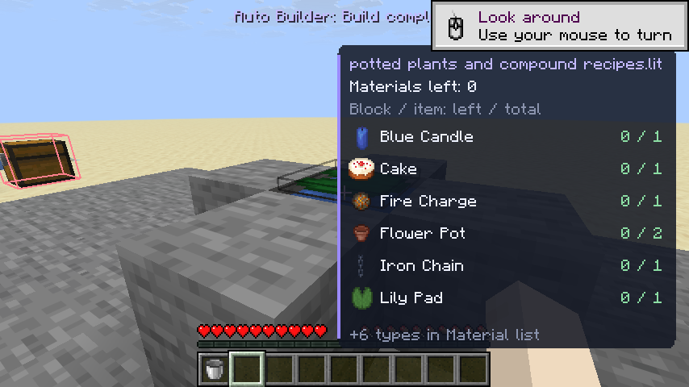
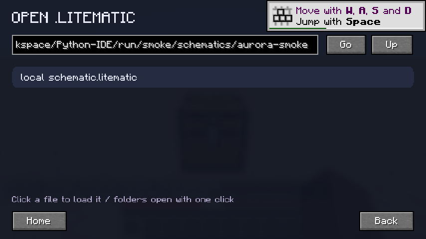
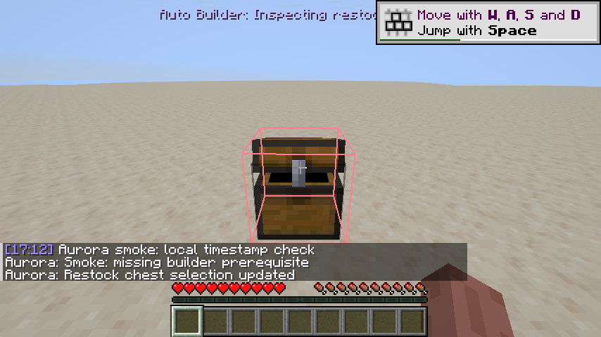
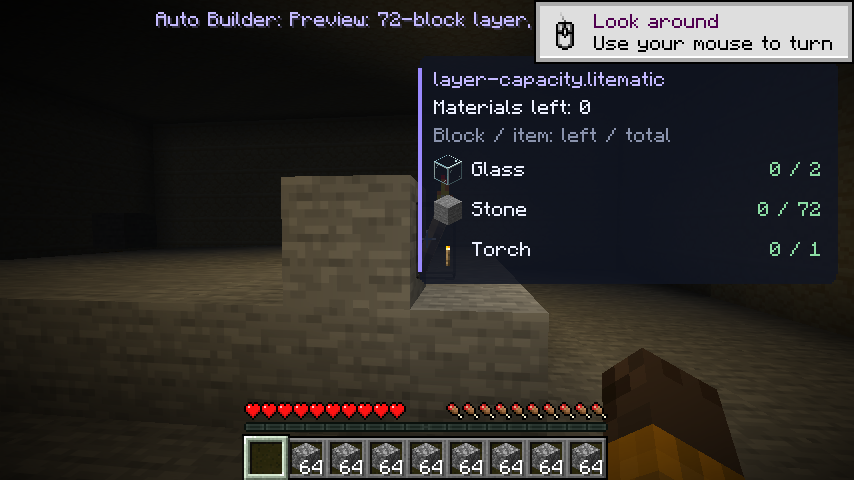
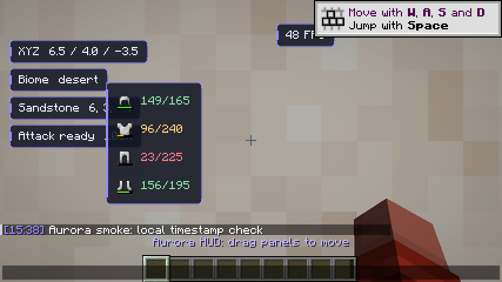

# Minecraft-Client — Aurora

En Fabric-klient för **Minecraft Java Edition 26.3** med en mörk, animerad meny,
lila accenter, fem modulkategorier och sökning över alla kategorier.

En separat [Aurora Launcher](launcher/README.md) finns också, med ett nytt
animerat gränssnitt och installation av Minecraft, Fabric och Aurora-modden.
Den behöver ett registrerat Microsoft-app-ID för sin inloggning; se
[inloggningsguiden](launcher/MICROSOFT_LOGIN.md). Mod-JAR-filen nedan kan
fortfarande användas i din befintliga launcher.

## Ladda ner och installera

1. [Ladda ner aurora-client-1.10.0.jar](https://raw.githubusercontent.com/powerebraceit/Minecraft-Client/v1.10.0/releases/1.10.0/aurora-client-1.10.0.jar).
2. Installera [Fabric Loader](https://fabricmc.net/use/installer/) **0.20.1 eller senare** för **Minecraft 26.3**.
3. Lägg JAR-filen i `mods`-mappen för den Minecraft-instans du använder.
   I en vanlig Windows-installation är det `%APPDATA%\.minecraft\mods`.
4. Starta Fabric-profilen med **Java 25** (Minecraft 26.3:s Java-version).
5. Öppna en värld och tryck på **höger Shift**.

Det behövs **ingen separat Fabric API-JAR**. Aurora levereras i en enda mod-JAR;
Minecraft och Fabric Loader installeras via launchern. JAR-filen ska inte startas
med dubbelklick eller `java -jar`.

## Menyn

- Klicka på **Combat, Movement, Render, World eller Misc** för att välja kategori.
- Skriv i sökfältet för att söka efter namn, beskrivning eller kategori i hela katalogen.
- Vänsterklicka på en modulrad för att slå på eller av modulen. Scrolla för fler resultat.
- **Högerklicka på en modulrad** för att öppna modulens inställningar. Där kan
  du ändra modulens hotkey. HUD-moduler har dessutom bakgrund, textskugga,
  accentfärg och återställning av position. Zoom har styrka och mjuk övergång,
  och chattens tidsstämplar kan visa sekunder. Ändringarna sparas direkt.
- Klicka på **Menu key … / Change** längst ner och tryck på önskad tangent.
  Escape avbryter tangentbytet. Tangentnamnet visas enligt spelets tangentbordslayout.
- Höger Shift (eller din nya tangent) stänger menyn. Escape lämnar först sökfältet
  om det har fokus, och stänger sedan menyn.
- **Animations: On/Off** växlar mellan mjuka animationer och reducerad rörelse.
- Menyn pausar inte världen. Tangentöppningen är aktiv när ingen annan meny är öppen.

Moduler, menytangent, HUD-positioner och animationsval sparas i `config/aurora.properties`.
Alla moduler är avstängda vid första starten. För att återställa en glömd
menytangent, stäng spelet och ta bort raden `menu.key` från konfigurationsfilen.

## Auto Builder — välj en lokal fil

Auto Builder läser **`.litematic`-filer direkt från din dator**. Du behöver varken
Litematica eller MaLiLib. Öppna World och högerklicka på **Auto Builder**, välj
**Choose .litematic file...** och klicka på din fil. Filväljaren har mappar,
sökvägsfält samt Go, Up och Home. Efter filval öppnas materiallistan för den valda
filen direkt. **Preview in world** visar blocken i världen utan att starta bygget. När du aktiverar modulen utan att ha valt en fil
öppnas filväljaren automatiskt; Back eller Escape avbryter starten.

Förhandsvisningen visar schemats **riktiga blockmodeller och texturer med cirka
70 % opacitet (kan ändras i Auto Builder-inställningarna)**. Röda ramar visar saknade block; gula ramar visar fel block eller
fel blockstate, till exempel en felvänd trappa. Rätt placerade block döljs ur
previewn. Gräver du bort ett sådant block visas dess röda preview igen.
**G** flyttar schemats lägsta hörn
till dina fötter. **V** registrerar kistan du tittar på som restock-kista. Båda
tangenterna och kistmarkeringens färg kan ändras i modulens inställningar.
Starta bygget först när previewn står rätt. Bygget kräver allt återstående
material i ditt inventory eller registrerade kistor och arbetar lager för lager.

**A* och placeringskö i 1.10.0:** algoritmen är separerad i en loaderoberoende
Java-motor, en säker terrängadapter och en serverbekräftad placeringskö. Den söker
en nåbar ståplats med rätt sikt och räckvidd, planerar om när block ändras och
undviker upprepade misslyckade vägkanter. En utväg kontrolleras även i en simulerad
värld efter placeringen. Rotation och faktisk klickyta måste stämma överens.
Se [den dokumenterade Java-koden och det körbara exemplet](docs/BUILDER_ALGORITHM.md).
Kärnan kan återanvändas i Forge; den här byggda modden använder Fabric.

**Byggtempo och räckvidd i 1.9.0:** byggaren väljer närliggande block inom
samma lager, behåller målet under gång och stannar när en giltig placering finns.
Gångriktningen hålls skild från siktesrotationen. Vanliga block kan placeras utan
extra siktesväntan, med högst ett klick var fjärde speltick, cirka fem block per
sekund när material, sikt och serverbekräftelser tillåter det. Räckvidden är högst
**4,5 block från ögat till klickytan**, även om en annan mod höjer attributet.
Både block- och hinkklick kontrolleras igen precis före användning.

**Lager och inventory i 1.8.0:** hela lagret behöver inte få plats samtidigt.
Byggaren använder tillgängligt material först, hämtar en mängd som ryms och
fortsätter på samma lager. Den går vidare uppåt efter serverns bekräftelse.
Block som väntar på stöd från andra block i lagret skjuts upp och provas igen.
Placeringen söker gångbara platser med fri sikt till verkliga blockytor;
placering mot kistor använder sneak. Befintligt vatten kan bevaras när ett
vattenfyllt block placeras. Ett faktiskt hinder ger ett stopp med material och
position, utan att bygget felaktigt markeras färdigt.

Filval, preview, G-ankring, materialkontroll, gång till kista, materialhämtning och
serverbekräftat lagerbygge har testats i Minecraft 26.3 survival **utan externa
schematic-moddar**, med en riktig testfil som innehåller sten, en riktad trappa
och en dubbel slab. Se [användning och begränsningar](docs/AUTO_BUILDER.md).

Material-HUD:en visar den valda filens namn och **återstående / totalt** per material.
Även färdiga material visas, och listan fungerar när byggmodulen är avstängd.
Du kan flytta panelen med chatten öppen. Högerklicka Auto Builder och välj
**Material list...** för hela listan med ikoner och kolumnerna **Total**, **Left**,
**Have** och **Missing**. **Have** räknar spelarens huvudinventory och hotbar. **Materials HUD**
slår av/på den kompakta listan; **Background** ändrar dess bakgrund. När du väljer
en ny fil visas preview och material-HUD automatiskt igen. Materiallistan och byggaren använder samma recept. Block som kräver manuellt arbete
döljer inte övriga material.

**Vatten och lava:** materiallistan visar hinkikoner. Vatten kräver högst två
vattenhinkar; lava kräver en lavahink per återstående källblock. Flytande vätska
räknas inte som extra hinkar. Vid fler än två vattenkällor använder byggaren en
återfyllningspool. Förbered en tät, en block djup **2×2-bassäng med fast botten**
utanför schemat, inom 12 block. Klienten fyller två diagonala hörn och återanvänder
tomma hinkar först efter att servern bekräftat att vattnet återskapas. En befintlig
motsvarande vattenpool fungerar också. Du kan välja poolens hörn i inställningarna
med **Use water pool corner at your feet**. Läs [vätskeguiden](docs/AUTO_BUILDER.md).

**Flerstegsblock:** alla registrerade krukväxter räknas som blomkruka plus rätt
växt, exempelvis `potted_red_mushroom` → blomkruka + röd svamp. Byggaren placerar
krukan och planterar sedan växten. Ljustårtor räknar tårta + motsvarande ljus;
tända ljus behöver även en fire charge. Snölager, ljus, sjögurkor, sköldpaddsägg
och segmenterade växtblock räknar varje föremål. Vattenfyllda block räknar både
blockföremålet och vatten, med samma tvåhinksgräns och återfyllningspool.
Delvis färdiga recept räknar bara återstående steg.

Resolvern använder spelets register för alla blockföremål, inklusive väggvarianter,
frön och redstone. Ett automatiskt registertest går igenom **1286 block och 35723
blockstates**. Detta kontrollerar recept och material; det innebär inte att varje
blockstate kan byggas automatiskt i survival. Portaler, tillväxt, mekaniska
tillstånd och andra manuella moment finns kvar i previewn och hindrar inte att
övriga material visas. Ett bygge markeras färdigt först när de slutliga
blockstates stämmer. Se [registerrapporten](docs/placement-registry-26.3.tsv).

Äldre `.litematic`-filer med blocknamnet `minecraft:chain` läses nu som
`minecraft:iron_chain`, med riktning och vatteninställning bevarade.



















## Flytta HUD-paneler

Aktivera först de HUD-moduler du vill visa. Tryck **T** för att öppna chatten,
håll vänster musknapp över en HUD-panel och dra den till önskad plats. Släpp
musknappen för att spara. Positionen sparas även om du stänger chatten mitt i en
förflyttning. Du kan flytta Armor Status, FPS Counter, Coordinates, Biome Info,
Block Info och Attack Cooldown var för sig. Vanlig chattinmatning fungerar fortfarande.

Armor Status visar hjälm, bröstplåt, byxor och stövlar i utrustningsordning, med
ikoner, hållbarhetsstaplar och `kvar/max` bredvid varje ikon. Hållbarhetstexten blir
gul eller röd när rustningen börjar slitas. Endast utrustade delar visas. När chatten
är öppen visas en flyttbar platshållare även om ingen rustning är utrustad.

Positionerna anpassas till fönsterstorlek och GUI-skala och hålls ovanför chattens
inmatningsfält. För att återställa en panel till standardpositionen, stäng spelet
och ta bort dess `hud.<modulnamn>.x` och `.y`-rader i `config/aurora.properties`.

## Moduler

| Kategori | Modul | Funktion |
| --- | --- | --- |
| Combat | Attack Cooldown | Visar hur redo nästa slag är i procent. |
| Combat | Armor Status | Rustningsikoner med hållbarhet bredvid, nere till höger som standard. |
| Movement | Toggle Sprint | Håller sprintinmatningen aktiv; spelets vanliga rörelsekrav gäller. |
| Movement | Toggle Sneak | Håller smyginmatningen aktiv tills modulen stängs av. |
| Render | Zoom | Mjuk zoom till en fjärdedel av normalt synfält. |
| Render | Coordinates | Visar XYZ-position. |
| Render | FPS Counter | Visar bildfrekvens. |
| World | Block Info | Visar namn och position för blocket du tittar på. |
| World | Biome Info | Visar aktuell biom. |
| World | Auto Builder | Läser lokala `.litematic`-filer, visar preview och bygger lager för lager med restock. |
| Misc | Chat Timestamps | Lägger till lokal klocktid på nya chattmeddelanden. |

Rörelseändringarna gäller bara spelinmatningen och lämnar tangentinställningarna
orörda. HUD och zoom kräver en laddad värld. HUD följer spelets döljning av gränssnittet.

## Bilder från Minecraft 26.3




## Bygga och testa

Krav: **JDK 25**, internetåtkomst till Gradle, Maven Central, Fabric och Mojangs
spel- och resursservrar. Gradle-versionen är låst i wrappern och verifieras med SHA-256.

```bash
./gradlew build
```

På Windows: `gradlew.bat build`. Installationsfilen skapas i
`build/libs/aurora-client-1.10.0.jar`; filen med `-sources` är källkod.

```bash
./gradlew runClient     # interaktiv utvecklingsklient
./gradlew runSmoke      # automatiskt integrationstest i en separat lokal värld
```

`runSmoke` kräver en grafisk session. På Linux med mjukvarurendering kan testet köras med:

```bash
LIBGL_ALWAYS_SOFTWARE=1 SDL_VIDEO_FORCE_EGL=1 \
  xvfb-run -a -s '-screen 0 1280x800x24' ./gradlew runSmoke
```

Integrationstestet ligger i `src/smoke`, ingår inte i den distribuerade JAR-filen
och använder en egen spelkatalog, `run/smoke`. Det kontrollerar verklig spelstart,
världsladdning, höger Shift, sökning och musklick, tangentbyte via menyn, sparade
inställningar, chatt, rörelse och kamerazoom samt återställning när moduler stängs av.
Testet verifierar även fyra rustningsikoner, dragning via chattens mushändelser,
sparade HUD-positioner, vanlig chattinmatning och ändrad GUI-skala.
Testet sparar skärmbilder och en resultatfil; Gradle misslyckas om kontrollerna inte slutförs.

Bygget kör även 34 grundkontroller, sex tester för HUD-positioner, två tester för modulinställningar,
19 tester för byggplanering, tre tester för gångvägar, sju tester för `.litematic`-läsaren, sex tester för preview/materialantal och sju vätsketester via JUnit.
Speltestet verifierar dessutom filval, avbruten filväljare, texturerad preview,
röda/gula ramar, döljning av rätt placerade block, återvisning efter borttagning,
materiallistor, flyttning av material-HUD och G-ankring. Bildkontroller jämför
pixlar inne på blockytan med preview på/av i både vanligt och förbättrat
transparensläge. Tester för blandade scheman med vatten och byte av vald fil körs också, liksom
restock och ett faktiskt survival-bygge i två lager med trappa och dubbel slab. Ett separat survival-moment laddar en
äldre kedjefil och bygger en kedja, tre vattenkällor och två lavakällor. Det
kontrollerar att endast två vattenhinkar räcker via pool/påfyllning, att en
lavahink hämtas från restock-kistan och att fyra tomma hinkar finns kvar efteråt.
Ett regressionstest bygger också ett lager med **70 sten + 2 glas** vid negativa
koordinater, med **35 fulla stackar andra föremål och bara en användbar plats**.
Det kontrollerar flera kistturer, lagergränser, en väggfacklas stöd och placering
ovanpå en kista. Separata tester täcker portionshämtning, receptordning och stopp
när stöd saknas. Ett tempo- och räckviddstest bygger tolv synliga block från samma
plats och kontrollerar en rak gångväg till ett block åtta block bort. I det senare
fallet höjs testspelarens attribut till åtta; faktiska klick måste fortfarande
hålla sig inom 4,5 block.
Speltestet har körts
lokalt på Minecraft **26.3**, Fabric Loader **0.20.1**, Java **25** och Linux med
Mesa-mjukvarurendering. Windows, andra modpaket och inloggad multiplayer har inte
testats i den här miljön.

GitHub Actions bygger JAR-filen, kör kontrollerna och sparar byggartefakter.

För molnuppgifter: använd befintlig checkout i `/workspace/Python-IDE`.
Varje uppgift har redan en isolerad miljö; skapa inte en Git-worktree utan uttrycklig begäran.
