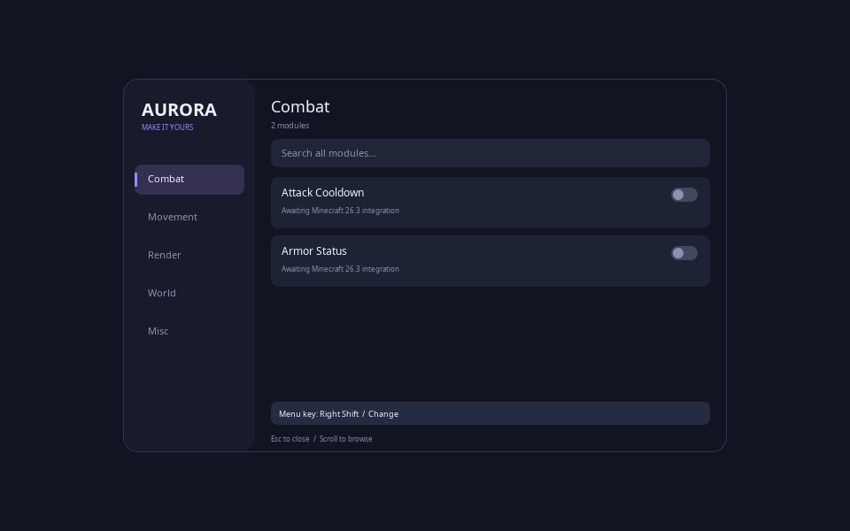

# Minecraft-Client — Aurora (work in progress)

En Minecraft Java-klient med målversion **26.3**. Designen har en mörk palett,
lila accentfärg, mjuka animationer och kategorierna **Combat, Movement, Render,
World och Misc**. Sökfältet söker i alla kategorier. Menytangenten börjar på
**höger Shift** och kan ändras i menyn; Escape avbryter en tangentändring.

## Aktuell status

Det här är för närvarande en **versionsoberoende Java-kärna**, inte en körbar
Minecraft-mod. Exakt versionsstöd, Fabric-integration, spelmoduler och en
installerbar JAR återstår. Ingen kompatibilitet med Minecraft 26.3 har verifierats.
Katalogens moduler kan inte aktiveras förrän de har en verklig spelimplementation.

Implementerat:

- Modulregister med de fem kategorierna, global sökning och toggle-livscykel.
- Menyrendering via ett separat Canvas-gränssnitt, hover-effekter, animerade
  reglage och öppningsanimation, scrollning och tangentbyte.
- Sparbara inställningar med atomisk filersättning, säker standardtangent vid
  ogiltig konfiguration och stöd för reducerade animationer.
- Fristående kontroller för konfiguration, sökning, modulernas livscykel och
  menyinteraktioner.

Modulförslag: Attack Cooldown, Armor Status, Toggle Sprint, Toggle Sneak, Zoom,
Coordinates, FPS Counter, Block Info, Biome Info och Chat Timestamps.

## Testa kärnan

Kör `bash scripts/test-core.sh` med JDK 21+. I den här molnmiljön har samma
kontroller körts med Eclipse ECJ 3.42 och Java 21, eftersom endast en JRE var
förinstallerad. 30 kontroller passerade. GitHub Actions är konfigurerat att köra
kontrollerna med ett komplett JDK; fjärrkörningen är ännu inte verifierad.

Med ett JDK 21 eller senare, från repots rot (Bash):

```bash
mkdir -p build/classes
javac --release 21 -d build/classes $(find src/main/java src/test/java -name '*.java')
java -ea -cp build/classes dev.aurora.CoreTest
```

En bild av menydesignen kan genereras utan Minecraft:

```bash
java -Djava.awt.headless=true -cp build/classes dev.aurora.DesignPreview
```



## Återstående för Minecraft-versionen

1. Verifiera att exakt version 26.3 finns i Mojangs och Fabrics versionslistor.
2. Använd den versionens Java-krav, Fabric Loader och dokumenterade rendering/input-API.
3. Implementera Canvas med spelets renderer och anslut menyn till spelets skärmar.
4. Registrera ändringsbar menytangent och återställ aktiverade moduler när spelet är redo.
5. Implementera modulernas speleffekter och återställ ändrade spelinställningar när
   moduler stängs av eller världen lämnas.
6. Bygg och testa den färdiga modden i Minecraft; publicera JAR och installationsanvisning.

Klienten ska distribueras som egen mod-JAR, utan Mojangs spelkod. Fabric Loader
installeras separat i launchern. Ytterligare bibliotek ska bäddas in när deras
licenser och Fabric stöder det.

För molnuppgifter: använd befintlig checkout i `/workspace/Python-IDE`.
Varje uppgift har redan en isolerad miljö; skapa inte en Git-worktree utan uttrycklig begäran.
