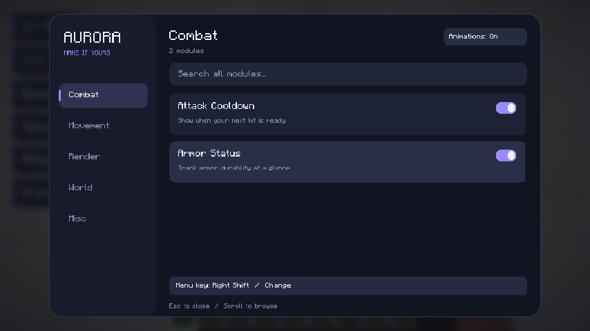
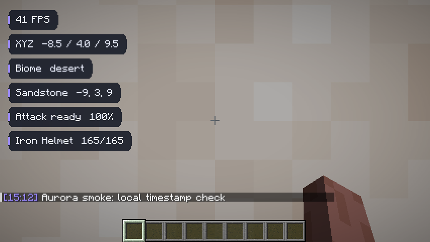

# Minecraft-Client — Aurora

En Fabric-klient för **Minecraft Java Edition 26.3** med en mörk, animerad meny,
lila accenter, fem modulkategorier och sökning över alla kategorier.

## Ladda ner och installera

1. [Ladda ner aurora-client-1.0.0.jar](https://raw.githubusercontent.com/powerebraceit/Minecraft-Client/v1.0.0/releases/1.0.0/aurora-client-1.0.0.jar).
2. Installera [Fabric Loader](https://fabricmc.net/use/installer/) **0.20.1 eller senare** för **Minecraft 26.3**.
3. Lägg JAR-filen i `mods`-mappen för den Minecraft-instans du använder.
   I en vanlig Windows-installation är det `%APPDATA%\.minecraft\mods`.
4. Starta Fabric-profilen med **Java 25** (Minecraft 26.3:s Java-version).
5. Öppna en värld och tryck på **höger Shift**.

Det behövs **ingen separat Fabric API-JAR**. Aurora levereras i en enda mod-JAR;
Minecraft och Fabric Loader installeras via launchern. JAR-filen ska inte startas
med dubbelklick eller `java -jar`.

## Menyn

- Klicka på **Combat, Movement, Render, World eller Misc** för att välja kategori.
- Skriv i sökfältet för att söka efter namn, beskrivning eller kategori i hela katalogen.
- Klicka på en modulrad för att slå på eller av modulen. Scrolla för fler resultat.
- Klicka på **Menu key … / Change** längst ner och tryck på önskad tangent.
  Escape avbryter tangentbytet. Tangentnamnet visas enligt spelets tangentbordslayout.
- Höger Shift (eller din nya tangent) stänger menyn. Escape lämnar först sökfältet
  om det har fokus, och stänger sedan menyn.
- **Animations: On/Off** växlar mellan mjuka animationer och reducerad rörelse.
- Menyn pausar inte världen. Tangentöppningen är aktiv när ingen annan meny är öppen.

Moduler, menytangent och animationsval sparas i `config/aurora.properties`.
Alla moduler är avstängda vid första starten. För att återställa en glömd
menytangent, stäng spelet och ta bort raden `menu.key` från konfigurationsfilen.

## Moduler

| Kategori | Modul | Funktion |
| --- | --- | --- |
| Combat | Attack Cooldown | Visar hur redo nästa slag är i procent. |
| Combat | Armor Status | Visar utrustad rustning och återstående hållbarhet. |
| Movement | Toggle Sprint | Håller sprintinmatningen aktiv; spelets vanliga rörelsekrav gäller. |
| Movement | Toggle Sneak | Håller smyginmatningen aktiv tills modulen stängs av. |
| Render | Zoom | Mjuk zoom till en fjärdedel av normalt synfält. |
| Render | Coordinates | Visar XYZ-position. |
| Render | FPS Counter | Visar bildfrekvens. |
| World | Block Info | Visar namn och position för blocket du tittar på. |
| World | Biome Info | Visar aktuell biom. |
| Misc | Chat Timestamps | Lägger till lokal klocktid på nya chattmeddelanden. |

Rörelseändringarna gäller bara spelinmatningen och lämnar tangentinställningarna
orörda. HUD och zoom kräver en laddad värld. HUD följer spelets döljning av gränssnittet.

## Bilder från Minecraft 26.3





## Bygga och testa

Krav: **JDK 25**, internetåtkomst till Gradle, Maven Central, Fabric och Mojangs
spel- och resursservrar. Gradle-versionen är låst i wrappern och verifieras med SHA-256.

```bash
./gradlew build
```

På Windows: `gradlew.bat build`. Installationsfilen skapas i
`build/libs/aurora-client-1.0.0.jar`; filen med `-sources` är källkod.

```bash
./gradlew runClient     # interaktiv utvecklingsklient
./gradlew runSmoke      # automatiskt integrationstest i en separat lokal värld
```

`runSmoke` kräver en grafisk session. På Linux med mjukvarurendering kan testet köras med:

```bash
LIBGL_ALWAYS_SOFTWARE=1 SDL_VIDEO_FORCE_EGL=1 \
  xvfb-run -a -s '-screen 0 1280x800x24' ./gradlew runSmoke
```

Integrationstestet ligger i `src/smoke`, ingår inte i den distribuerade JAR-filen
och använder en egen spelkatalog, `run/smoke`. Det kontrollerar verklig spelstart,
världsladdning, höger Shift, sökning och musklick, tangentbyte via menyn, sparade
inställningar, chatt, rörelse och kamerazoom samt återställning när moduler stängs av.
Testet sparar skärmbilder och en resultatfil; Gradle misslyckas om kontrollerna inte slutförs.

Bygget kör även 32 fristående beteendekontroller via JUnit. Speltestet har körts
lokalt på Minecraft **26.3**, Fabric Loader **0.20.1**, Java **25** och Linux med
Mesa-mjukvarurendering. Windows, andra modpaket och inloggad multiplayer har inte
testats i den här miljön.

GitHub Actions bygger JAR-filen, kör kontrollerna och sparar byggartefakter.

För molnuppgifter: använd befintlig checkout i `/workspace/Python-IDE`.
Varje uppgift har redan en isolerad miljö; skapa inte en Git-worktree utan uttrycklig begäran.
