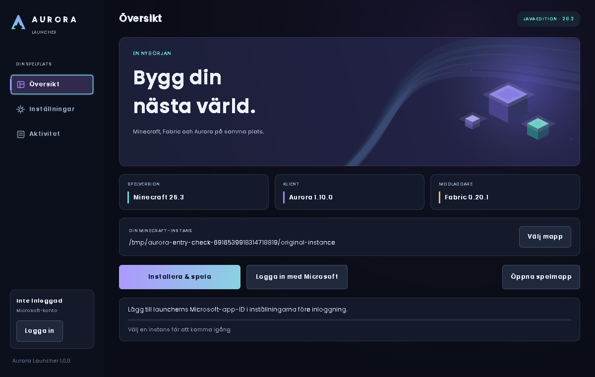

# Aurora Launcher 1.0.0

**Förhandsversion:** utgivarens Microsoft-appregistrering återstår att konfigurera.

Fristående launcher med ett nytt, animerat Aurora-gränssnitt i mörkblått,
lila och cyan. Installerar **Minecraft Java 26.3**, **Fabric Loader 0.20.1**,
**Java 25** vid behov och den medföljande **Aurora-modden 1.10.0** i en egen
instans. Ingen separat Dawn- eller Prism-installation behövs.

[Ladda ner Windows-paketet (ZIP)](https://github.com/powerebraceit/Minecraft-Client/releases/download/launcher-v1.0.0/AuroraLauncher-1.0.0.zip)
eller [bara launcher-JAR:en](https://github.com/powerebraceit/Minecraft-Client/releases/download/launcher-v1.0.0/AuroraLauncher-1.0.0.jar).
Läs app-ID-kravet nedan före installation.



## Börja här

1. Installera **Java 17 eller senare** för att öppna launchern, om det saknas.
   Java 25 för själva spelet ordnas automatiskt när du startar en installation.
2. Öppna `AuroraLauncher-1.0.0.jar`, eller kör
   `java -jar AuroraLauncher-1.0.0.jar`. Windows-paketet innehåller också
   `Starta Aurora.bat` som visar startfel i ett konsolfönster.
3. I **Inställningar** anger utgivaren sitt offentliga **Microsoft-app-ID**.
   Den här versionen innehåller ännu inget registrerat ID. Ett eget
   Minecraft-konto ersätter inte appregistreringen. Se
   [MICROSOFT_LOGIN.md](MICROSOFT_LOGIN.md).
4. Klicka **Logga in med Microsoft**. Öppna Microsoft-adressen, ange koden
   från launchern och använd ett konto med tillgång till Minecraft Java.
5. Klicka **Installera & spela**. Första installationen laddar ner spelet,
   bibliotek, resurser och eventuellt Java. Följ förloppet i **Aktivitet**.

Efter att utgivaren har konfigurerat en fungerande appregistrering använder
spelare sina vanliga Microsoft-konton. Varje spelare behöver inte registrera
en egen app. Microsoft/Xbox/Minecraft måste också godkänna appens API-åtkomst;
ett valfritt GUID räcker inte.

## Funktioner

- Microsofts device-code-inloggning i webbläsaren, förnyelse av sessioner,
  verifiering av spellicens och Minecraft-profil samt utloggning.
- Val av separat spelmapp, automatisk eller vald Java, minne och stängning
  av launcherfönstret när spelet startar. Spelet fortsätter köras.
- Hashkontroller av spel-, biblioteks-, resurs- och Java-filer, tillfälliga
  nedladdningar och återanvändning av verifierade filer.
- Installation av medföljande Aurora 1.10.0. Tidigare identifierade
  Aurora-modversioner flyttas till `mods/.aurora-backups`. Övriga moddar
  lämnas kvar. Detta är ingen nätbaserad automatisk uppdaterare; en ny
  Aurora-modversion behöver följa med en ny launcher eller installeras separat.
- Logg i instansens `logs/aurora-launcher.log` med maskering av kända
  kontotoken. Ingen lösenordsinmatning, klienthemlighet eller offlineinloggning.
- Java-argument överförs genom en privat argumentfil för långa sökvägar på
  Windows; filen tas bort när spelet avslutas.

Inställningar sparas i `~/.aurora-launcher/settings.properties`.
Endast Microsofts refresh-token sparas i `account-session.json` i samma mapp,
med åtkomst begränsad till filägaren där operativsystemet stöder det.
**Filen är inte krypterad.** Utloggning tar bort den sparade sessionen.
Lösenord sparas aldrig. `--config sökväg` väljer en separat inställningsfil.

Standardinstansen ligger här:

| System | Mapp |
| --- | --- |
| Windows | `%APPDATA%\AuroraLauncher\instances\default` |
| macOS | `~/Library/Application Support/AuroraLauncher/instances/default` |
| Linux | `~/.local/share/aurora-launcher/instances/default` |

## Om omarbetningen

Det uppladdade Corz-arkivet innehöll dekompilerad Java och en skyddad native-VM,
inte ett komplett byggbart launcherprojekt. Därför är Aurora en ny implementation
av launcherfunktionerna och grafiken. Den innehåller inga Corz-programklasser,
native-bibliotek, DonutSMP-länkar eller automatiska serveranslutningar.
Poppins-typsnittet återanvänds med sin medföljande
[SIL Open Font License](src/main/resources/licenses/OFL-Poppins.txt).

## Bygga och testa

Kräver JDK 17 eller senare och Bash. Inga externa Java-bibliotek behövs.
Modfilen i `releases/1.10.0/` måste finnas i checkouten.

```bash
bash launcher/build.sh
bash launcher/check.sh --gui
java -jar launcher/dist/AuroraLauncher-1.0.0.jar --version
java -jar launcher/dist/AuroraLauncher-1.0.0.jar
```

JAR och källkods-JAR hamnar i `launcher/dist/`. Kontrollerna använder isolerade
filer, simulerade auth-/installationssvar och en ofarlig Java-process.
GUI-kontrollen kör riktiga Swing-komponenter och musinteraktion i en grafisk
session; på Linux kan `xvfb-run` användas. GitHub Actions kör samma kontroller.
De [340 lokala kontrollerna och testgränserna](VALIDATION.md) dokumenteras separat.

Officiella 26.3-/Fabric-metadata och Java 25-manifest har dessutom kontrollerats
mot servrarna. **Riktig kontoinloggning och en spelstart genom denna nya launcher
har ännu inte verifierats**, eftersom ett registrerat app-ID saknas. Tester av
Aurora-modden i spelet beskrivs separat i projektets huvudsakliga README.
Windows och macOS har metadata-/argumentkontroller men har inte körts här.
